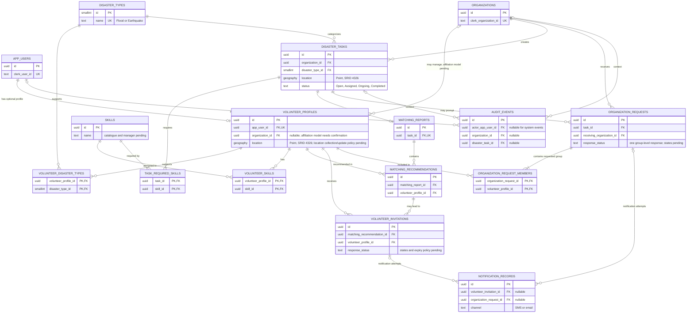

# VolunteerConnect database ERD — design draft

**Status:** Draft for review  
**Scope:** Phase 02 database design  
**Database:** Supabase PostgreSQL with PostGIS  
**Identity provider:** Clerk (no Supabase Auth)

This document describes the proposed application data model before migrations are written. It is a logical ERD, not an approved physical schema. The table set follows Phase 02's proposal; fields and constraints affected by unresolved product decisions are intentionally left open. No application tables or migrations are created by this document.

**Implementation note:** A separate physical schema migration currently exists as an unapplied draft. Its column types and fields do not fully match this logical diagram. Do not use the migration as proof that this ERD has been implemented. See the [design review](./database-design-review.md) and [Phase 02 acceptance review](./phase-02-acceptance-review.md).

## ERD

`||--o|` on `DISASTER_TASKS` to `MATCHING_REPORTS` means a task can have zero or one report while matching has not run, and never more than one. A unique constraint on `matching_reports.task_id` must enforce the maximum. The ERD does not prescribe when matching runs.

## Entity notes and key constraints

| Entity | Design notes |
|---|---|
| `app_users` | One row per Clerk user identity. `clerk_user_id` is unique. Clerk remains the source of authentication and organization membership; do not store credentials or tokens here. |
| `organizations` | One row per Clerk Organization. `clerk_organization_id` is unique. A Clerk workspace does not imply official registration; organization verification workflow remains undecided. |
| `volunteer_profiles` | Optional one-to-one profile for an application user, allowing users without a volunteer profile. `location` is a PostGIS `geography(Point, 4326)` candidate. Affiliation field/cardinality depends on the approved account-management model. |
| `disaster_types` | Seed/reference values limited to Flood and Earthquake. A fixed lookup table plus controlled seed data keeps task and volunteer category references consistent. |
| `skills` | Reference catalogue. Names, catalogue governance, and matching semantics await approval. |
| `volunteer_disaster_types`, `volunteer_skills` | Join tables implementing many-to-many relations; composite primary keys prevent duplicate links. |
| `disaster_tasks` | Belongs to exactly one owning organization. Status is constrained to Open, Assigned, Ongoing, Completed. Enforce ownership in backend and RLS; status changes are authorized only for the owning organization. |
| `task_required_skills` | Join table. Whether these are all-required or any-required for matching remains unresolved; the schema must not imply a rule. |
| `matching_reports` | One-to-zero-or-one per task, enforced by unique `task_id`. Report is a recommendation snapshot; responses must not trigger regeneration. |
| `matching_recommendations` | Recommendation rows belong to a report and identify a volunteer profile. Store explainability evidence only for the three approved criteria (skills, proximity, local-area knowledge); exact score, weights, distance and ranking are pending. |
| `volunteer_invitations` | Volunteer-level invitation and response are distinct from task status. Exact response states, expiry, and simultaneous invitation behavior are pending. Actual response is recorded in-app. |
| `organization_requests` | Request directed to one receiving organization. Group acceptance/decline belongs on this parent row so the receiving organization responds to the whole group. Exact state model is pending. |
| `organization_request_members` | Join rows identify the requested volunteer group. A request must contain at least one member; whether a member must be associated with the receiving organization depends on the affiliation model. |
| `notification_records` | Attempts/channels are records of notification delivery only, never response records. Use an idempotency key/provider message identifier when provider behavior is decided. Do not place credentials here. |
| `audit_events` | Append-oriented history. Ordinary clients must not insert, update, or delete audit records directly. Retain references where possible; avoid cascade deletion of operational history. Event vocabulary and retention are pending. |

## Relationship and deletion policy

- Use `ON DELETE RESTRICT` (or soft-delete/archival behavior) for organizations, tasks, reports, invitations, requests, and audit-linked records where deleting a parent would erase operational history. Do not cascade from task or organization deletion into audit history.
- Cascading deletion is appropriate only for pure association rows (`volunteer_skills`, `volunteer_disaster_types`, `task_required_skills`) if the referenced parent is legitimately removed. Whether volunteer/account deletion should be hard or soft is unresolved; do not implement it until retention and deletion rules are approved.
- Foreign keys should be indexed where they are used for joins, authorization checks, or parent lookups. Add GiST indexes for task and volunteer geography after confirming the spatial query pattern. A spatial index does not establish a matching radius.
- Coordinate input is longitude/latitude in EPSG:4326; validate latitude and longitude bounds before constructing geography values. Do not collect continuous or background location data.
- Reference tables and application records require RLS. Policy expressions must wait for inspection of actual Clerk JWT claims and the verified backend/database authorization design; do not guess claim names.

## RLS permission matrix (design intent)

| Table | Intended access boundary |
|---|---|
| `app_users` | User can access only their own permitted identity row; identity comes from verified Clerk claims. |
| `organizations` | Verified members access only their organization; task creation/management also checks registration authorization and ownership. |
| `volunteer_profiles` | Volunteer and authorized managing organization only; protect contact/location fields from unrelated organizations. |
| `disaster_types`, `skills` | Read access as approved reference data; writes restricted to controlled maintenance. |
| volunteer/task join tables | Access follows the parent volunteer profile or task. |
| `disaster_tasks` | Owning organization only for management; other reads require an approved visibility rule. |
| `matching_reports` | Authorized task-owning organization only. |
| `matching_recommendations` | Owning organization sees report; each volunteer sees only their own relevant recommendation/invitation information. |
| `volunteer_invitations` | Volunteer can respond only to their own invitation; owning organization may view its invitation records under approved rules. |
| `organization_requests`, `organization_request_members` | Requesting task owner and verified receiving-organization members under policy; receiving organization decides the group as a whole. |
| `notification_records` | Restricted to the relevant authorized recipient/organization and trusted backend as required; no client response mutations. |
| `audit_events` | Read access restricted by approved operational roles; ordinary clients cannot mutate. Trusted backend writes only. |

This matrix is a target for later policy design, not executable policy. Confirm JWT claims and test with representative tokens before writing RLS.

## Decisions required before physical schema is finalized

1. Organization registration/verification workflow and what constitutes task-creation authorization.
2. Volunteer onboarding, organization-affiliated account management, and whether a volunteer can have multiple organizational affiliations.
3. Skill catalogue, its manager, and multiple-skill matching semantics.
4. Location source/update process, privacy boundary, and location retention.
5. Matching distance threshold, scoring, weighting, ranking, and tie-breaking.
6. Invitation response states, expiry, no-response handling, and simultaneous invitation rules.
7. Whether cross-organization requests can contain only organization-affiliated volunteers and the exact group membership rules.
8. Notification providers, deduplication behavior, and provider event identifiers.
9. Personal-data retention, CNIC handling, and account/data deletion behavior.
10. Actual Clerk JWT claims and the trusted authorization path for RLS.

## Diagram and schema synchronization

Update this ERD in the same change as any approved schema migration. The migrations become the physical source of truth; keep the ERD aligned with actual table names, keys, cardinalities, and constraints. Phase 02 specifies Eraser.io for the final database diagram; this Mermaid source is a version-controlled design draft that can be reviewed before producing or importing the Eraser diagram.
